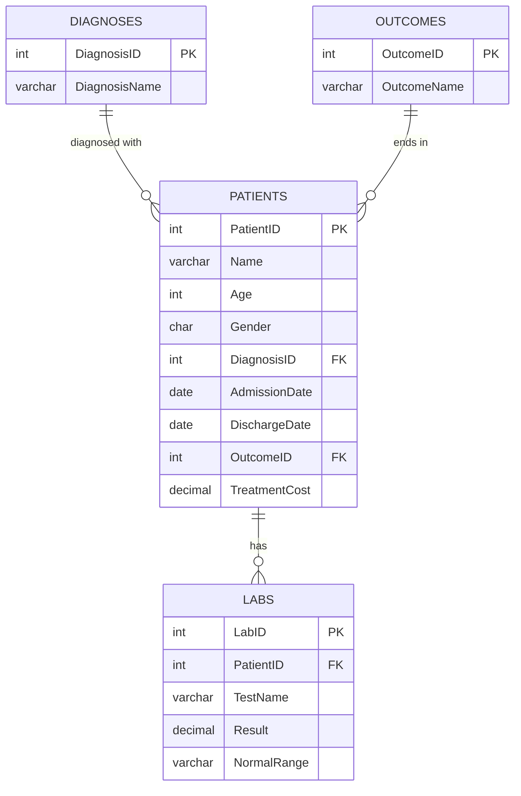

# Healthcare Database: SQL Analytics & Outcome-Risk Experiment

A relational database for hospital admissions, with SQL analysis of treatment costs, outcomes and lab results, plus a small scikit-learn experiment predicting poor patient outcomes.

**Stack:** MySQL 8 · SQL (joins, CTEs, window functions) · Python (pandas, scikit-learn) · Jupyter

> **Data note:** All data in this repository is **synthetic** (randomly generated, no real patients). Findings below describe this dataset only and are not clinical conclusions.

---

## What this project demonstrates

- Designing a normalized relational schema with primary and foreign keys
- Writing multi-table joins, aggregations, CTEs and window functions (`RANK()`, `AVG() OVER (PARTITION BY ...)`)
- Cleaning, merging and feature-engineering CSV data with pandas
- Training a baseline classifier **and evaluating it honestly**, including where it fails (see [ML Experiment](#ml-experiment))

---

## Dataset

| Table | Rows | Description |
|---|---|---|
| `Patients` | 200 | Age (30-89), gender, diagnosis, admission/discharge dates (Jan-Jun 2025), outcome, treatment cost |
| `Diagnoses` | 10 | Hypertension, Diabetes, Heart Disease, Asthma, Stroke, COPD, Cancer, Arthritis, Kidney Disease, Liver Disease |
| `Outcomes` | 3 | Recovered, Complicated, Deceased |
| `Labs` | 200 | Test results for 131 patients across 6 tests (Blood Pressure, Blood Sugar, Cholesterol, Creatinine, Hemoglobin, Vitamin D) |

### Schema



---

## Repository structure

```
├── Table creation.sql     # Schema (DDL) + 9 analytical queries
├── Risk_model1.ipynb      # Data merge, feature engineering, model training & evaluation
├── riskmodel1.pkl         # Saved logistic regression model (joblib)
├── patients.csv           # 200 patient admissions
├── diagnoses.csv          # Diagnosis lookup
├── outcomes.csv           # Outcome lookup
├── labs.csv               # Lab results
├── Combined file.xlsx     # All tables combined in one workbook
└── requirements.txt       # Python dependencies
```

---

## SQL analysis (`Table creation.sql`)

| # | Question | Techniques |
|---|---|---|
| 1 | Full patient lab history with diagnosis and outcome | 4-table `JOIN` |
| 2 | Average lab result per diagnosis and test | `GROUP BY`, `AVG` |
| 3 | Patients with the most abnormal lab flags | Conditional `WHERE`, `COUNT` |
| 4 | Which diagnosis has the highest average treatment cost? | `GROUP BY`, `ORDER BY` |
| 5 | Older male patients (65+) with a "Complicated" outcome | Multi-condition filter |
| 6 | Lab results for one patient over time | Filtering, ordering |
| 7 | Outcome distribution by diagnosis | `GROUP BY` on two columns |
| 8 | Treatment cost ranking by diagnosis | CTE, `AVG() OVER (PARTITION BY ...)`, `RANK()` |
| 9 | Running average of lab results per patient and test | Window function with `ORDER BY` |

---

## Key findings (synthetic data, n = 200)

- **Outcomes are evenly split:** 34.5% Deceased, 34.0% Complicated, 31.5% Recovered.
- **Treatment cost:** Mean is about 6,105 per patient (range 2,054-9,973). Arthritis has the highest average cost (about 6,679) and COPD the lowest (about 5,533).
- **Length of stay:** Median 9 days, but the mean is 29.2 and the maximum 169, so the distribution is heavily right-skewed.
- **Non-recovery rate by diagnosis** ranges from 82% (Hypertension) to 50% (Liver Disease).
- **Age was not associated with outcome:** 67% of patients over 65 did not recover, versus 69% of those 65 or younger.

> With only 10-28 patients per diagnosis, differences between diagnoses are small enough that they could easily be random variation. This is a tooling and method demonstration, not evidence of real clinical patterns.

---

## ML experiment

**Goal:** Predict whether a patient has a poor outcome (`Complicated` or `Deceased`) from `Age`, `LengthofStay` and `TreatmentCost`.

**Method:** 70/30 train-test split, logistic regression (`max_iter=500`), evaluated with a classification report and ROC curve.

**Result:** The model does **not** beat a trivial baseline.

| Metric | Value |
|---|---|
| Test accuracy | 0.72 |
| Baseline (predict everyone is high risk) | 0.72 |
| Recall for "Recovered" class | 0.00 |
| ROC AUC | about 0.48 (close to random) |

**Why this happens:** the dataset is randomly generated, so age, stay length and cost carry no real signal about outcome, and the classes are imbalanced (about 68% poor outcomes). The model collapses to predicting the majority class.

**What I'd do differently with real data:**
- Use only features available *at admission* (length of stay and final cost are only known after treatment, which would leak information about the outcome)
- Handle class imbalance (`class_weight='balanced'`, stratified splits)
- Report precision/recall per class and compare against a baseline from the start
- Try tree-based models and cross-validation

---

## How to run

**1. Create the database** (MySQL 8+, required for window functions)

```sql
SOURCE "Table creation.sql";
```

Then load the four CSV files into their matching tables (for example with MySQL Workbench's *Table Data Import Wizard*).

**2. Run the notebook**

```bash
pip install -r requirements.txt
jupyter notebook Risk_model1.ipynb
```

---

## Known limitations

- Synthetic data: lab values are uniformly random, and `NormalRange` values are not consistent with the test they belong to.
- `Labs` has no test date and 69 of 200 patients have no lab records (83 have exactly one), so **true longitudinal lab trends are not possible** with this dataset. Queries 6 and 9 show the technique rather than a real trend.
- The model is a baseline and is not suitable for any real clinical use.

## Possible next steps

- Add a `TestDate` column to `Labs` for genuine time-series analysis
- Build a Power BI or Tableau dashboard on top of the database
- Add an admission-time-only model with proper class-imbalance handling
- Wrap the model in a small Streamlit app

---

**Author:** [Harshit Jha](https://www.linkedin.com/in/harshit-jha0203)
